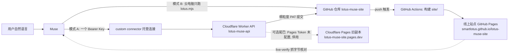

# 架构

接口契约的唯一真源是 `CONTRACT.md`；本文解释各职责为什么放在现在的位置。

## 一图流



纯文本版（终端里看）：

```
用户 --自然语言--> Muse
  模式 B: Muse 云电脑 --只跑 scripts/lotus.mjs--> git push(main)
  模式 A: Muse --单个 Bearer Key--> Worker API --细粒度 PAT--> GitHub 提交(main)
git push --触发 GitHub Actions--> 构建 site/ --> GitHub Pages 线上站点
线上站点 --live-verify.mjs 抓回字节--> 确认文字真的出现了
```

## 各职责住在哪里

| 职责 | 位置 | 理由 |
|---|---|---|
| 数据结构与校验 | `lib/model.mjs` | 纯函数，Node 与 Worker 共用（契约第 3 节禁止 IO），本地 CLI 与线上 API 因此校验同一套规则 |
| HTML 渲染 | `lib/template.mjs` | 同上，模板改动只此一处 |
| content -> site 构建 | `lib/build.mjs` | 纯内存、字节级确定，同输入同输出，方便测试与差异比对 |
| 操作流水事件 | `lib/journal.mjs` | journal 只增不写，事件形状统一定义 |
| 路由与响应封装 | `lib/http.mjs` + `api/src/index.js` | Worker 是唯一的特权执行点，路由表在 lib 便于本机用 `serve-api.mjs` 跑同一份代码 |
| 本机维护 | `scripts/lotus.mjs` | 不依赖任何云凭据即可产出可提交的 `site/`，Muse 不可用时零降级 |
| 本地演练 API | `scripts/serve-api.mjs` | 把 Worker handler 架在 node:http 上，用 curl 验证真实 Worker 代码 |
| 线上验收 | `scripts/live-verify.mjs` | 验收判据是"页面字节里出现了标记"，不是"接口 200" |
| Muse 交接物 | `muse/` | SKILL/manifest 用 Muse 自己的文件格式，接入步骤与话术给不熟悉运维的用户 |
| 内容源数据 | `content/` | 记录与页面是 JSON，人可审、git 可回滚 |
| 媒体源文件 | `media/` | 构建时复制进 `site/assets/media/` |
| 写前快照 | `backups/` | 每次写操作前全量快照，restore 的原料 |
| 构建产物 | `site/` | 提交进仓库；CI（`.github/workflows/pages.yml`）部署时重新构建一遍作核对，仓库内副本保证可追溯 |

## 为什么只有 Worker 持有特权凭据

1. Muse 的自定义连接器只接受"一个 Base URL + 一个 API Key"（其文档
   connectors.md 第 148 行）。把 GitHub 或 Cloudflare 凭据递给 Muse
   既做不到（没有那种连接形状），也不应该（账号级特权）。
2. Worker（模式 A）是唯一的写入点：它内部拿两把互相独立的窄凭据。
   细粒度 PAT 只允许本仓库 contents 读写；Pages 上传 Token 只允许向
   指定 Pages 项目传产物（2026-11-06 起未配置，对应尾巴停用）。
   任何一把泄漏都不给出另一把的能力。
3. Muse 拿到的 Key 只是 Worker 的准入门票：它能触发 Worker 已实现的
   十来个动作，动作背后 Worker 自己决定提交与部署。模式 B 下 Muse 拿到的是
   单仓库 deploy key / fine-grained PAT，权限同样只有这一个仓库的 contents。
4. 部署顺序有因果关系：先 GitHub 提交成功，push 触发 GitHub Actions 部署；
   提交失败即整体失败，不部署。这样仓库与线上不会漂移，git 历史永远是唯一真相。

## 数据流（一次"加一条记录"）

```
Muse: GET /site (读现状, 拿 next_sequence)
用户: 确认文字
Muse: POST /entries { ..., expect_sequence: N }
Worker: 校验 -> 写前快照 backups/ -> 经 GitHub Contents API 提交
        content/entries/000N.json + 更新后的 site.json + journal.jsonl
        + 重建的 site/** （一次原子提交，作者 lotus-muse-bot）
Worker: 提交成功 -> push 触发 GitHub Actions 构建部署 -> 返回 commit_sha 与 deploy.url
Muse: 等一两分钟, GET deploy.url 抓页面字节, 确认文字出现 -> 汇报用户
```

本地 CLI 走同一条流水线的离线版：快照、写 JSON、追加 journal、
重建 site/、`git add -A && git commit`（push 即触发同一套自动部署）。
